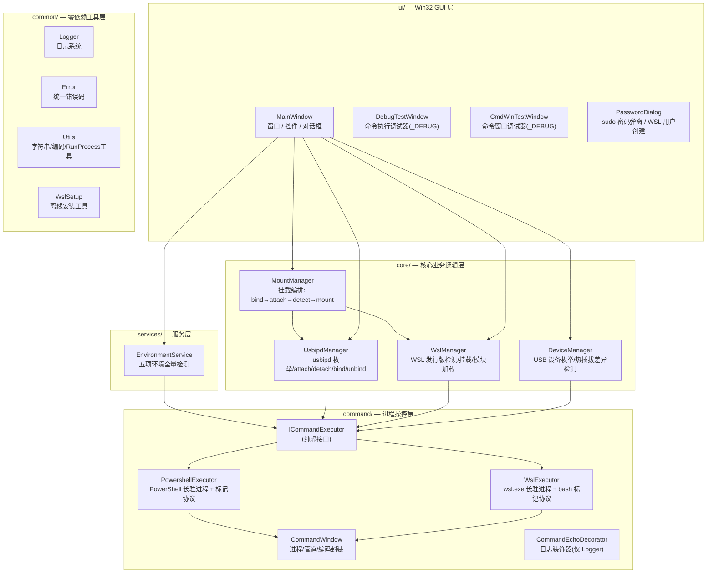
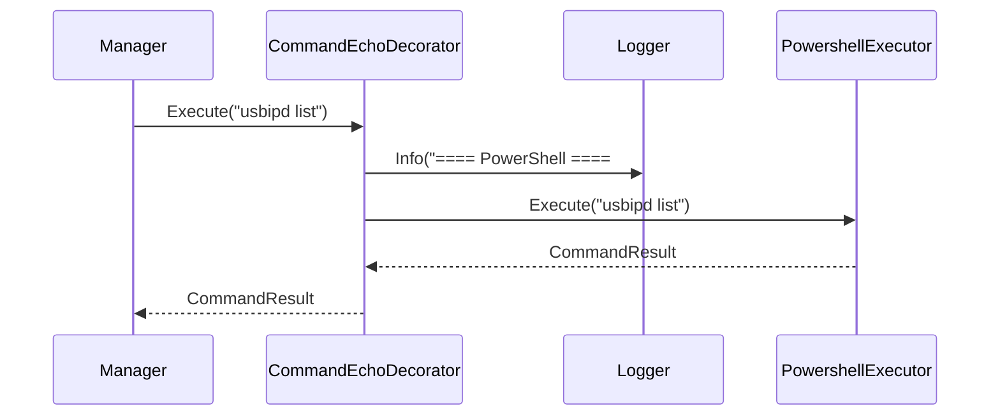
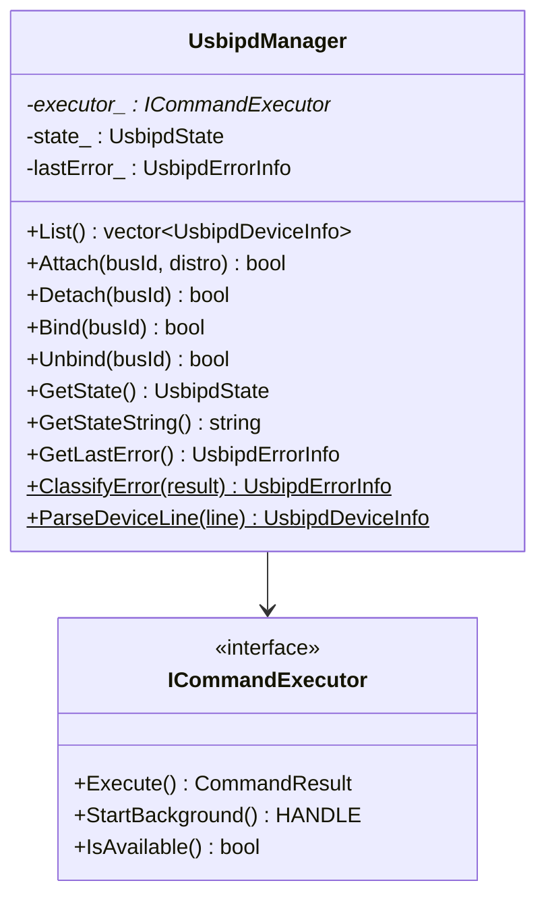
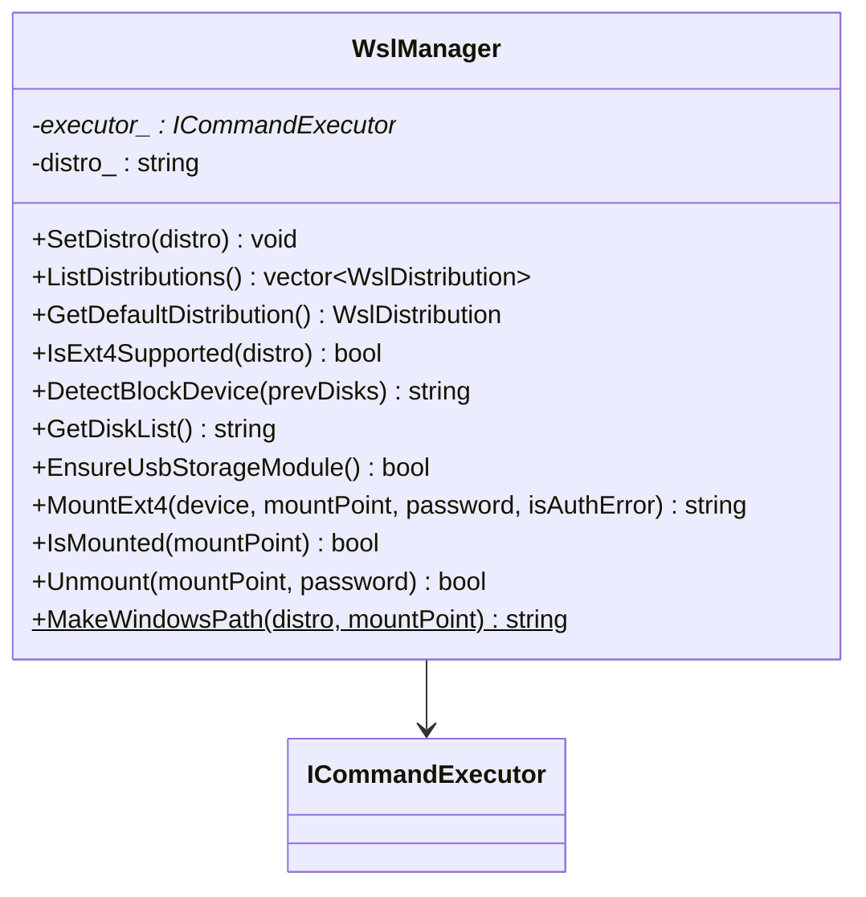
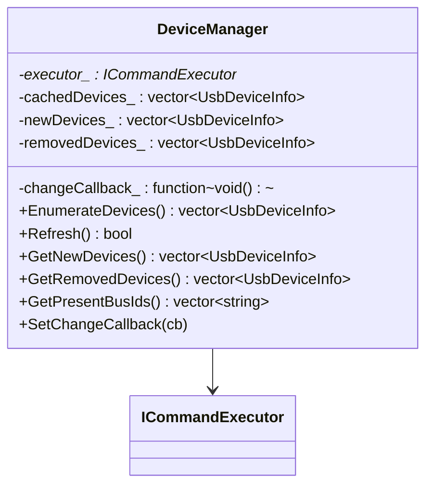
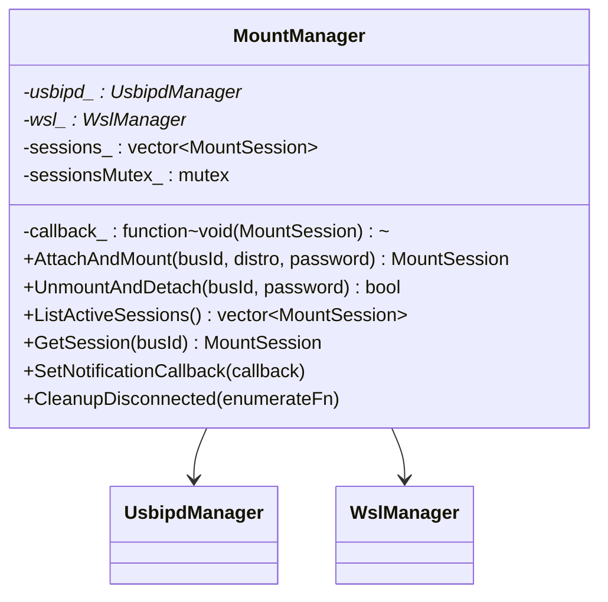
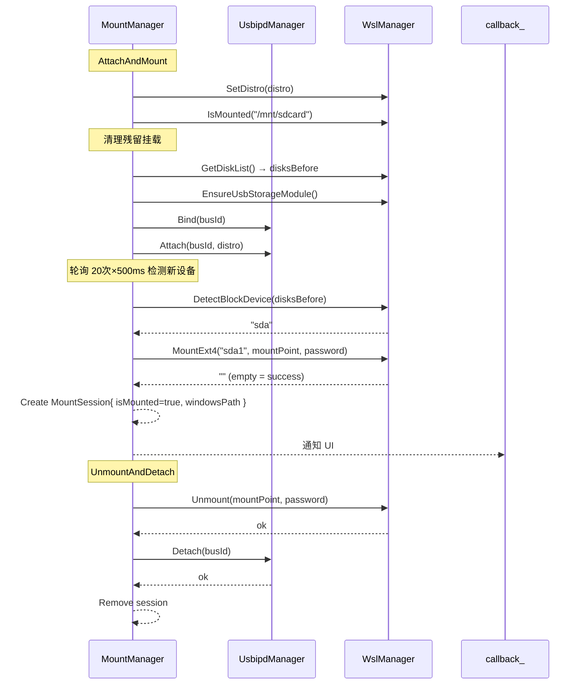
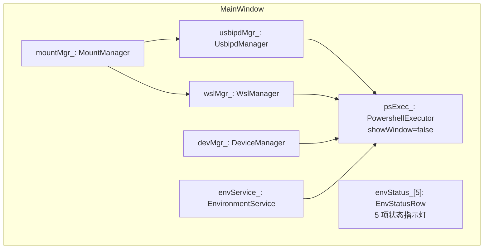
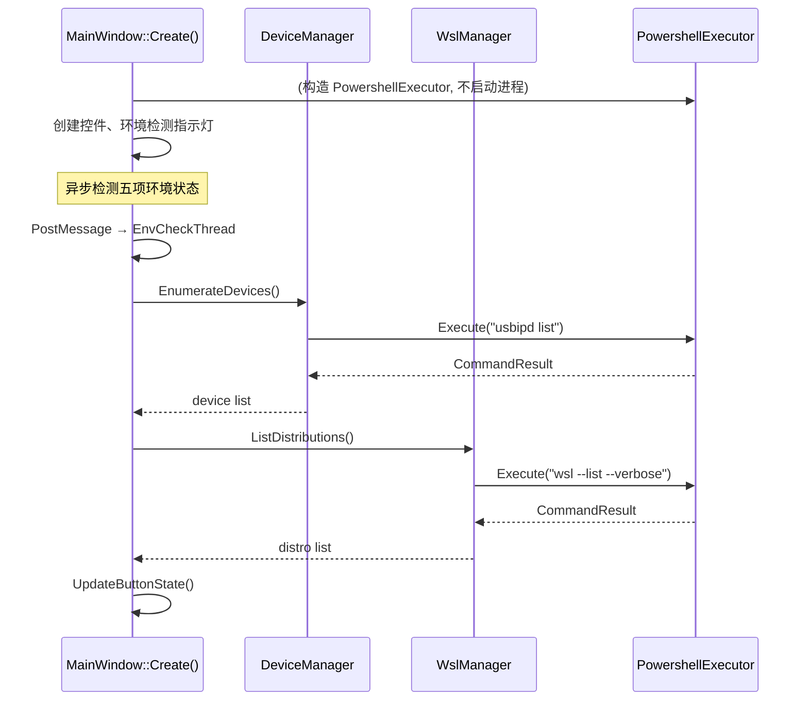
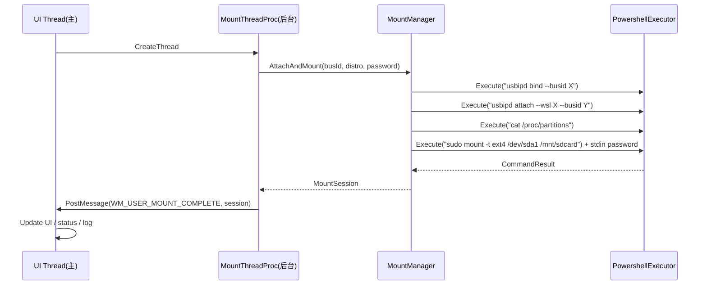

# Ext4WslHelper 架构设计文档

> 通过 WSL2 + usbipd 在 Windows 上访问 EXT4 格式 SD 卡的 GUI 工具。
> 所有外部进程调用通过 `ICommandExecutor` 接口，core 层不直接创建任何进程。

---

## 一、整体分层架构



### 分层依赖规则

```
ui → core → command/ICommandExecutor (接口)
                    ↓
         [PowershellExecutor | WslExecutor] (具体实现，无上游依赖)
                    ↓
              [CommandWindow] (进程/管道/编码)

services → core → command/ICommandExecutor (接口)

common/ → 全层可用，零依赖
```

- `ui/` 调用 `core/` 的业务方法，不直接操作任何进程
- `core/` 各 Manager 通过 `ICommandExecutor` 接口（构造注入）执行命令，不直接创建进程
- `command/` 是底层进程操控模块：`ICommandExecutor.h` 定义纯虚接口，各实现内嵌 `CommandWindow` 管理单一长驻进程，通过标记协议 (`###X4W_CSTART/END###`) 多次收发命令，封装编码转换和超时控制
- `common/` 零依赖，纯工具函数和类型定义
- `services/EnvironmentService` 通过 `ICommandExecutor` 检测各项环境状态
- `CommandEchoDecorator` 包裹 `ICommandExecutor`，仅通过 `Logger` 记录命令标签，无控制台回显

---

## 二、command 层 — 进程操控

### 2.1 接口定义

```cpp
struct CommandResult {
    DWORD exitCode;
    std::string stdOut;
    std::string stdErr;
};

class ICommandExecutor {
    virtual CommandResult Execute(commandLine, stdinInput="", timeoutMs=30000) = 0;
    virtual HANDLE StartBackground(commandLine) = 0;
    virtual bool IsAvailable() = 0;
};
```

### 2.2 实现类对比

| 类 | 原理 | 进程管理 | 输出捕获 |
|---|---|---|---|
| **PowershellExecutor** | `CommandWindow` + `powershell.exe -NoProfile -NoExit` 长驻进程 | 单一长驻进程，通过 stdin/stdout 管道 + 标记协议收发命令，析构时 `exit` → `WaitForExit(3s)` → `Terminate` | 标记协议解析 (`###X4W_CSTART/END###`)，OEM→UTF-8 编码转换，行分割 + Logger 日志 |
| **WslExecutor** | `CommandWindow` + `wsl.exe -d <distro>` 长驻进程 | 同上；有 `SetPersistentWindow` 支持替换为外部传入的 `CommandWindow` | 同上，bash 风格标记协议 |
| **CommandWindow** | `CreateProcess` + 匿名管道 | 一次 `Create` 创建进程，通过 `Write` / `ReadAllLines` 多次 I/O，最后 `exit` → `WaitForExit` → `Close` | 原始数据 + `ProcessAndLog` 编码转换/剥离 ANSI/分块读取 |

### 2.3 标记协议

所有命令用标记包裹，从 stdout 管道解析输出和退出码：

```
PowerShell 模式：
  try{[System.IO.File]::WriteAllText('CONOUT$', "> echoCmd\r\n")}catch{}
  ###X4W_CSTART###
  <实际命令>
  $r=$LASTEXITCODE; Write-Host '###X4W_CEND###'$r

Bash 模式（WSL）：
  echo "> echoCmd" > /dev/tty
  echo ###X4W_CSTART###
  <实际命令>
  echo ###X4W_CEND###$?
```

### 2.4 CommandEchoDecorator



日志输出示例：
```
[2026-05-29 11:04:17]  ==== PowerShell ==== # usbipd list
[2026-05-29 11:04:19]  - busid 5-2 (USB Mass Storage) attached - Alpine
[2026-05-29 11:04:19]  ==== PowerShell ==== # wsl --list --verbose
[2026-05-29 11:04:20]   Alpine (default)   Running   2
```

### 2.5 CommandWindow — 进程/管道/编码封装

`CommandWindow` 是进程操控的核心封装：

- **进程管理**: `Create` 创建长驻 shell 进程，`WriteLine` 写入命令，`ReadAllLines`/`ReadAllRaw` 读取输出，`WaitForExit`/`Terminate`/`Close` 结束
- **管道 I/O**: 支持 `showWindow=true`（可见控制台窗口 + `WriteToConsole`）和 `showWindow=false`（后台隐藏 + 管道）
- **编码处理**: 自动检测 UTF-16LE/OEM/ANSI 编码并转为 UTF-8，剥离 ANSI 转义序列
- **活动超时**: `ReadAllRaw` 以活动超时轮询管道，有数据重置计时，无数据则 `Sleep(50)`，避免命令长时间静默时挂死
- **静态工具**: `ProcessAndLog` 供外部使用

```cpp
// 核心方法摘要
bool Create(const std::wstring& shellPath, bool showWindow, bool createPipe);
bool WaitForExit(DWORD timeoutMs, DWORD* exitCode);
bool WriteLine(const std::string& command);
std::vector<std::string> ReadAllLines(DWORD timeoutMs);
std::string ReadAllRaw(DWORD timeoutMs);
std::string FlushRead();              // 读取当前管道中所有可用数据（立即返回）
void WriteToConsole(const std::string& text);  // showWindow 时写入可见窗口
bool IsRunning() const;
DWORD GetProcessId() const;
static std::vector<std::string> ProcessAndLog(const std::string& rawData);
```

---

## 三、core 层 — 业务逻辑

### 3.1 UsbipdManager



| 方法 | 底层命令 | 说明 |
|---|---|---|
| `List()` | `usbipd list` | 枚举所有 USB 设备（当前版本使用简化命令） |
| `Attach(busId, distro)` | `usbipd attach --wsl [distro] --busid X` | 附加设备到 WSL（无 `wsl` 子命令模式） |
| `Detach(busId)` | `usbipd detach --busid X` | 从 WSL 分离，已分离则幂等返回成功 |
| `Bind(busId)` | `usbipd bind --busid X` | 跨重启持久化 |
| `Unbind(busId)` | `usbipd unbind --busid X` | 取消绑定 |

**错误分类**：`ClassifyError()` 通过预先定义的关键字表（`kUsbipdErrorTable`，在 `.cpp` 中集中维护）匹配原始输出中的典型错误关键词（如 `"not found"`、`"already attached"`、`"access denied"`），返回结构化的中文错误信息和操作建议。

**状态机**：内部维护 `UsbipdState` 枚举（`Unknown / NotInstalled / ServiceStopped / ServiceRunning / DeviceRecognized / DeviceBound / DeviceAttached / DeviceUnbound / Error`），`List()` 执行后自动根据设备状态更新，`MainWindow` 通过 `GetState()` / `GetStateString()` 查询。

### 3.2 WslManager



| 方法 | 底层命令 | 说明 |
|---|---|---|
| `ListDistributions()` | `wsl --list --verbose` | 枚举安装的 WSL 发行版，列位置解析（语言无关） |
| `GetDiskList()` | `cat /proc/partitions` | 获取挂载前磁盘列表（快照） |
| `DetectBlockDevice()` | `cat /proc/partitions` (前后对比) | 在 WSL 内通过 `/proc/partitions` 对比检测新 `sdX` 设备 |
| `EnsureUsbStorageModule()` | `lsmod → modprobe usb-storage` | 确保 `usb_storage` 内核模块已加载（usbipd attach 前调用） |
| `MountExt4()` | `sudo mount -t ext4 /dev/<dev> <path>` | 挂载 EXT4 分区，先尝试读写，失败后自动降级为只读 (`-o ro`) |
| `IsMounted()` | `mountpoint -q <path>` | 检查目录是否为挂载点 |
| `Unmount()` | `sudo umount <path>` | 循环卸载（支持多层挂载），失败后降级为 lazy umount |

### 3.3 DeviceManager



`UsbDeviceInfo` 是 `UsbipdDeviceInfo` 的别名（`using UsbDeviceInfo = UsbipdDeviceInfo;`），共享 `UsbipdManager::ParseDeviceLine()` 解析逻辑。

封装 `UsbipdManager.List()`，提供热插拔差异检测能力（`Refresh()` 比对快照）：

- 首次调用 `Refresh()`：缓存当前设备列表，返回 `false`
- 后续调用：与缓存对比，计算 `newDevices_` / `removedDevices_`
- 有变化 → 触发 `changeCallback_()` 通知 UI

### 3.4 MountManager — 核心编排





**关键流程细节**：
- 挂载点固定为 `/mnt/sdcard`（而非时间戳格式）
- 设备检测使用 `cat /proc/partitions` 前后对比，过滤 `sdX` 设备，最多 20 次 × 500ms = 10s
- 挂载候选尝试顺序：`device+1` → `device+p1` → 全部失败则回滚 detach
- 挂载失败自动回滚（detach 设备），同时区分 sudo 密码错误 (`isAuthError`)

---

## 四、ui 层 — Win32 GUI

### 4.1 MainWindow 组合关系



**MainWindow 内部不持有 `CommandEchoDecorator`**。`psExec_` 是 `PowershellExecutor` 实例，各 Manager 直接通过构造注入该 `ICommandExecutor*`。所有命令通过 `Logger` 集中记录。

### 4.2 界面布局

```
┌─────────────────────────────────────────────────────┐
│ [设备下拉框]  [检测设备]  [刷新日志]  [退出]        │
├─────────────────────────────────────────────────────┤
│  环境检测指示灯（5 项）：                              │
│  ● 虚拟化  ● WSL 功能  ● WSL 内核  ● Alpine  ● usbipd │
│  [一键初始化]                                         │
├─────────────────────────────────────────────────────┤
│  Windows 访问路径: […]                                │
│  状态: [就绪/挂载中/已挂载/错误]                       │
│  [挂载]  [卸载]                                       │
├─────────────────────────────────────────────────────┤
│  日志输出框（可折叠）                                   │
└─────────────────────────────────────────────────────┘
```

### 4.3 初始化时序



### 4.4 挂载流程（后台线程）



### 4.5 跨线程通信模式

```
后台线程                         UI 线程（主）
    │                               │
    ├─ 执行挂载/卸载/环境检测等耗时操作 │
    │                               │
    └─ PostMessage(WM_USER_*) ──────► HandleMessage
                                        │
                                        ├─ 更新控件状态
                                        ├─ AppendLog 写入日志框
                                        └─ SetMountStatus 更新状态栏
```

自定义消息：

| 消息 | 参数 | 用途 |
|---|---|---|
| `WM_USER_MOUNT_COMPLETE` | `wParam = MountSession*` | 挂载完成 |
| `WM_USER_UNMOUNT_COMPLETE` | `wParam = bool ok` | 卸载完成 |
| `WM_USER_LOG_APPEND` | `lParam = wchar_t*` | 追加日志文本 |
| `WM_USER_ENV_CHECK_COMPLETE` | `wParam = EnvironmentStatus*` | 环境检测完成 |
| `WM_USER_ENV_INIT_COMPLETE` | 无 `wParam`/`lParam` | 环境初始化完成 |

**跨线程通信模式**：后台线程通过 `PostMessage` 发送自定义消息到主窗口，主线程 `HandleMessage` 中处理 UI 更新。`AppendLog` 使用 `PostMessage` 向主线程发送 `WM_USER_LOG_APPEND` 消息，由消息处理函数中的 `SendMessage` 获取日志编辑框当前文本长度后追加。

---

## 五、common 层 — 共享工具

| 模块 | 文件 | 功能 |
|---|---|---|
| **Logger** | `Logger.h/.cpp` | 单例日志系统，支持文件输出和内存缓冲区供 UI 日志框显示；`Log(level, msg)` / `Info / Debug / Warning / Error`；支持 `SetLevel` 级别过滤 |
| **Error** | `Error.h` | 统一错误码枚举 `ErrorCode`（涵盖环境检测、命令执行、usbipd 操作、WSL 操作、设备异常等），`Result` 结构体（`Ok()`/`Fail()`） |
| **Utils** | `Utils.h/.cpp` | UTF-8↔UTF-16 互转、OEM→UTF-8 编码转换（`OemToUtf8`）、直接进程创建（`RunProcess` / `RunProcessStreaming`）、字符串工具（`Split`/`Trim`/`StartsWith`/`Replace`） |
| **WslSetup** | `WslSetup.h/.cpp` | Windows 版本检查（`GetWindowsBuildNumber`/`IsWindowsVersionSupported`）、离线安装工具（`ImportAlpineTar` 将 Alpine tar 导入 WSL、`InstallUsbipdMsi` 安装 usbipd-win MSI、`FindPackageFile` 在 exe 目录搜索离线包） |

---

## 六、完整数据流示例

```
用户点击"挂载"按钮
    │
    ▼
MainWindow::OnMount()
    ├─ 检查 sudo 密码 → 无则弹 PasswordDialog
    ├─ isWorking_ = true, EnableControls(false)
    └─ CreateThread(MountThreadProc)
        │
        ▼
    MountThreadProc
        └─ mountMgr_.AttachAndMount(busId, "Alpine", password)
            │
            ├── 0. wslMgr_.SetDistro("Alpine")
            ├── 0. wslMgr_.IsMounted("/mnt/sdcard") → 清理残留
            │
            ├── 1. wslMgr_.GetDiskList() → "/proc/partitions" 快照
            ├── 2. wslMgr_.EnsureUsbStorageModule()
            │     ├── lsmod | grep usb_storage
            │     ├── 未加载 → modprobe usb-storage 2>&1
            │     └── 失败 → depmod -a → 重试 modprobe
            │
            ├── 3. usbipdMgr_.Bind("5-2")
            ├── 4. usbipdMgr_.Attach("5-2", "Alpine")
            │
            ├── 5. 轮询: wslMgr_.DetectBlockDevice(disksBefore) → "sda"
            │     └── 最多 20 次 × 500ms = 10s
            │     └── 超时 → Detach 回滚 → 返回 MountSession{status=Error}
            │
            ├── 6. wslMgr_.MountExt4("sda1", "/mnt/sdcard", password, &isAuthError)
            │     ├── 尝试 "sda1" (分区1)
            │     ├── 失败 → 尝试 "sda1p1" (分区p1)
            │     ├── 全失败 → Detach 回滚
            │     └── 成功 → MountSession{ isMounted=true, mountPoint="/mnt/sdcard",
            │                                 windowsPath="\\wsl.localhost\Alpine\mnt\sdcard" }
            │
            └── callback_(session) → PostMessage(WM_USER_MOUNT_COMPLETE)
        │
        ▼
    MainWindow::HandleMessage(WM_USER_MOUNT_COMPLETE)
        ├─ AppendLog("✓ 挂载成功")
        ├─ SetMountStatus("✓ 已挂载")
        ├─ EnableControls(true)
        ├─ isWorking_ = false
        └─ UpdateMountInfo() / UpdateButtonState()
```

---

## 七、现有文件清单

```
src/
├── command/                    # 进程操控层
│   ├── ICommandExecutor.h      # 纯虚接口
│   ├── PowershellExecutor.h/cpp   # PowerShell 长驻进程封装（标记协议）
│   ├── WslExecutor.h/cpp         # WSL 长驻进程封装（bash 标记协议）
│   ├── CommandWindow.h/cpp       # 进程/管道/编码封装
│   └── CommandEchoDecorator.h    # 命令日志装饰器（仅 Logger 记录）
│
├── core/                       # 核心业务逻辑层
│   ├── UsbipdManager.h/cpp     # usbipd 操作 + 错误分类 + 状态机
│   ├── WslManager.h/cpp        # WSL 发行版管理 + 挂载 + 模块加载
│   ├── DeviceManager.h/cpp     # USB 设备枚举 + 热插拔差异检测
│   └── MountManager.h/cpp      # 挂载编排（bind→attach→detect→mount）
│
├── ui/                         # Win32 GUI 层
│   ├── MainWindow.h/cpp        # 主窗口（控件、挂载、环境检测/初始化）
│   ├── DebugTestWindow.h/cpp   # 命令执行调试器（_DEBUG 模式）
│   ├── CmdWinTestWindow.h/cpp  # 命令窗口调试器（_DEBUG 模式）
│   ├── PasswordDialog.h/cpp    # sudo 密码对话框 + WSL 用户创建
│   └── Resource.h              # 资源标识符（控件 ID、自定义消息）
│
├── services/                   # 服务层
│   └── EnvironmentService.h/cpp # 环境全量检测（五项状态检测）
│
└── common/                     # 共享工具层
    ├── Logger.h/cpp            # 单例日志系统
    ├── Error.h                 # 统一错误码枚举 + Result
    ├── Utils.h/cpp             # 工具函数（编码转换、RunProcess、字符串）
    └── WslSetup.h/cpp          # 离线安装工具（版本检查、ImportAlpineTar、InstallMsi）
```

---

## 八、关键设计决策

| 决策 | 方案 | 理由 |
|---|---|---|
| **进程抽象** | `ICommandExecutor` 接口 + 构造注入 | core 层可纯逻辑测试，mock 注入即可 |
| **长驻进程** | Executor 内部维护单一长驻 shell 进程（`powershell.exe -NoProfile -NoExit` / `wsl.exe -d distro`），通过标记协议多次收发命令 | 消除每次 `Execute()` 创建进程的开销；CommandWindow 统一编码处理和超时控制 |
| **标记协议** | `###X4W_CSTART/END###` 包裹命令，从 stdout 管道解析输出和退出码 | 在持久会话中准确区分单次命令的输出边界 |
| **命令日志** | `CommandEchoDecorator` 在命令执行前记录命令文本+标签到 Logger | 不修改 Manager 代码，无侵入式添加可观测性；命令输出由 `CommandWindow::ProcessAndLog` 按行记录 |
| **日志格式** | `[YYYY-MM-DD HH:mm:ss]  message` | 完整日期时间，无级别字符，便于阅读和 grep |
| **跨线程通信** | `PostMessage(WM_USER_*)` | Win32 原生线程安全方案，无需额外同步 |
| **环境检测** | `EnvironmentService` 五项全量检测（虚拟化 / WSL 功能 / WSL 内核 / Alpine / usbipd） | 一次性返回结构化结果，UI 通过指示灯展示 |
| **离线安装** | exe 同目录放置离线包（`Alpine.tar` / `wsl*.msi` / `usbipd*.msi`），通过 `wslsetup::FindPackageFile` / `ImportAlpineTar` / `InstallMsi` 完成安装 | 避免网络下载失败、下载慢、URL 变化等问题；单 exe + 离线包即可在无网络环境部署 |
| **Alpine 发行版** | 使用 Alpine Linux 作为 WSL 挂载环境 | Alpine 镜像小（~5MB），支持 root 用户免 sudo，减少密码交互；`wsl --import` 命令稳定 |
| **设备检测** | `cat /proc/partitions` 前后对比，过滤 `sdX` 设备 | 不受 `lsblk` 输出格式变化影响，更稳定可靠 |
| **错误分类** | `UsbipdManager::ClassifyError()` 通过可维护的关键字表匹配 | 关键字表集中管理，人为可审阅、可追加，不修改匹配逻辑 |
